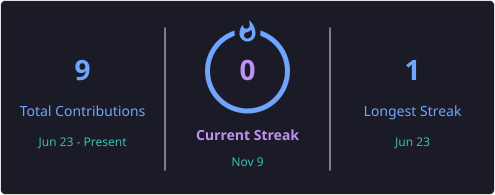

👨‍💻 Aditya Garhwal

<h3 align="center">🚀 Aspiring Software Developer | B.Tech CSE Student</h3>

  

---

🌌 About Me

- 🎓 B.Tech Computer Science Engineering Student
- 💻 Beginner Programmer passionate about technology
- 🌱 Learning C, C++ and Java
- 🐧 Exploring Linux and its ecosystem
- 🎯 Goal: Become a skilled Software Developer
- ⚡ Believe in continuous learning and improvement

---

🛠️ Tech Stack

  

---

📊 GitHub Statistics

  
  

---

🔥 Contribution Streak

  

---

🎯 My Goals

- [ ] Strengthen programming fundamentals
- [ ] Master Data Structures and Algorithms
- [ ] Build real-world projects
- [ ] Explore open-source development
- [ ] Improve problem-solving skills

---

💬 Developer Quote

  <i>"First, solve the problem. Then, write the code."</i>

---

  <b>✨ Learning Today | Building Tomorrow ✨</b>

